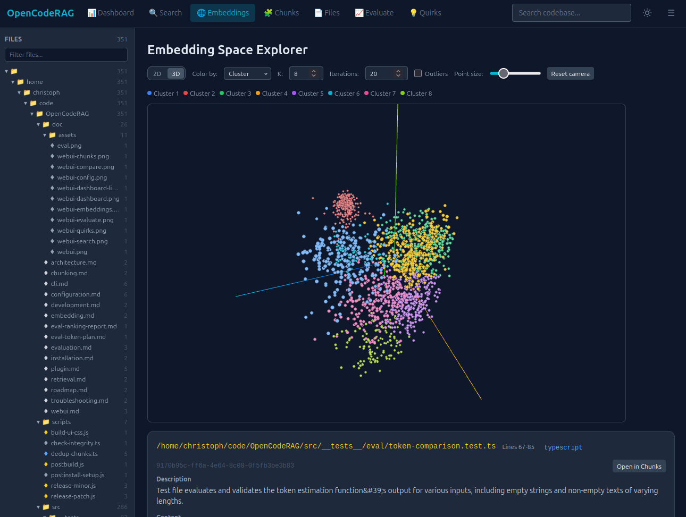

# OpenCodeRAG

**A local-first toolkit that gives AI coding agents search, memory, judgment, and guardrails.**

[](https://www.npmjs.com/package/opencode-rag-plugin)
[](LICENSE)

AI coding agents are capable, but they have four recurring weaknesses: they read whole files to find one function, they forget everything between sessions, they interrupt you with questions they could settle themselves, and they may run risky shell commands without a second opinion.

OpenCodeRAG addresses all these problems and more in one package:

- **Semantic Search**: retrieval tools that find relevant code parts by a rough description only
- **Persistent Memory**: vectorized memory, which keeps gotchas and decisions across sessions and automatically injects them into the context when necessary
- **Knowledge Base**: agents use and maintain a project wiki to understand the code base better
- **Basic Judgment**: a small local decision model that answers classification and routing questions
- **Guardrails**: shell guard, which evaluates shell commands for malignancy before they run
- **Image Description**: describes images with a local vision model for non-multimodal LLMs
- **Documentation Assistant**: maintains and adds code documentation where it is still missing or unclear

OpenCodeRAG is primarily built as an [OpenCode](https://opencode.ai) plugin. But it can also be run as a MCP server for other AI coding platforms or used as a standalone command-line tool. By default it works fully locally via Ollama, but it can also use OpenAI-compatible APIs.

No GPU is required, although it is recommended when using code and image descriptions. Smaller embedding models can still run fine on a modern CPU.

---

## Contents

- [What you get](#what-you-get)
- [Quick start](#quick-start)
- [How it works](#how-it-works)
- [Ways to use it](#ways-to-use-it)
- [Capabilities in detail](#capabilities-in-detail)
  - [1. Semantic code search](#1-semantic-code-search)
  - [2. Quirk memory](#2-quirk-memory)
  - [3. Decision model](#3-decision-model)
  - [4. Shell Guard](#4-shell-guard)
  - [5. Documentation and wiki modes](#5-documentation-and-wiki-modes)
  - [6. Image indexing](#6-image-indexing)
  - [7. Web UI, evaluation, and calibration](#7-web-ui-evaluation-and-calibration)
- [Tool reference](#tool-reference)
- [Configuration](#configuration)
- [Privacy and security](#privacy-and-security)
- [Limitations](#limitations)
- [Documentation index](#documentation-index)
- [Contributing and support](#contributing-and-support)
- [License](#license)

---

## What you get

| Capability | What it does for your agent | On by default |
|---|---|:---:|
| **Search** | Finds the relevant code by meaning and by exact symbol name, instead of reading whole files | Yes |
| **Memory** | Remembers gotchas, decisions, and past tool failures across sessions | Yes |
| **Decisions** | Classifies, routes, and scores short text locally, without spending agent tokens | No |
| **Protection** | Checks every shell command for destructive or malicious intent before it runs | No |
| **Documentation** | Drives the agent to document undocumented code (`/doc`) and to maintain a project wiki (`/wiki`) | Wiki: yes, Doc: no |
| **Vision** | Makes screenshots and diagrams searchable through generated descriptions | Yes |
| **Measurement** | Tracks token use, retrieval quality, and decision accuracy, with a web dashboard | Tools, always available |

**Why it is built this way**

- **Fewer tokens.** The agent gets the handful of relevant chunks, not entire files.
- **Search the way code is written.** AST-aware chunking keeps functions and classes intact. Hybrid vector and keyword search catches both meaning ("where is auth handled?") and exact names.
- **Local by default.** Embeddings, the vector store, and the optional decision model run on your machine. No source code leaves the workspace unless you configure a hosted provider.
- **Scales with the repository.** Incremental indexing and a background watcher keep the index current. An optional shared ClickHouse store supports large or multi-machine workspaces.

---

## Quick start

> **Package name:** only install `opencode-rag-plugin`. The npm package `opencode-rag` is an unrelated, discontinued project by a different author.

**Prerequisites:** Node.js v22+ and [Ollama](https://ollama.ai) (the default provider). OpenCode is optional; the CLI and MCP server work without it.

```bash
# 1. Install the plugin and the CLI
npm install -g opencode-rag-plugin

# 2. Set up the runtime, the workspace, and your models
#    (a short interactive wizard guides you through the configuration)
cd /path/to/your/project
opencode-rag setup

# 3. Build the index (may take a while)
opencode-rag index

# 4. Search from the terminal
opencode-rag query "authentication middleware"
```

Example output:

```
Querying: "authentication middleware"
Top-K: 10
Searching 1240 indexed chunks...

3 result(s) in 41ms:

  src/auth/middleware.ts:12-48
  Score: 0.8123
  ...
```

Open OpenCode in the same directory and the agent can use the tools right away.

<details>
<summary><strong>What does <code>opencode-rag setup</code> do?</strong></summary>

It handles the whole onboarding in one command:

- installs or verifies the machine-level runtime in `~/.opencode/`
- scaffolds the current workspace (`.opencode/` config, plugin entries, skill files)
- on the first run, or with `--reconfigure`, starts a **model wizard** for the embedding, description, vision, and decision models

A plain re-run only syncs the workspace files. The wizard is scriptable (`--yes`, `--provider`, `--base-url`, `--embedding-model`, `--description off`, and more), and `--skip-runtime` limits the run to the workspace. Use `opencode-rag update` to upgrade the runtime to a newer release.

`pnpm add -g`, `yarn global add`, and `bun add -g` work as drop-in replacements for npm. Setup and update detect which package manager owns the install.

</details>

### Optional add-ons

These are off by default and can be enabled later:

| Add-on | Enable with | Requires |
|---|---|---|
| [Shell Guard](#4-shell-guard) | `shellGuard.enabled` or `setup --shell-guard on` | tev1 via Ollama ≥ 0.35 |
| [Decision model](#3-decision-model) | `decision.enabled` or `setup --decision on` | tev1 via Ollama ≥ 0.35 |
| [Documentation mode](#documentation-mode-doc) | `documentationMode.enabled` | nothing extra |
| [Shared ClickHouse Vector Database](doc/clickhouse.md) | `vectorStore.provider: "clickhouse"` or `setup --vector-store clickhouse` | a ClickHouse server |

Two features are **on** by default and worth disabling if they do not fit your setup: [image descriptions](#6-image-indexing) (`imageDescription.enabled`, needs a vision model) and [wiki mode](#wiki-mode-wiki) (`wikiMode.enabled`).

> **Contributors:** clone the repo and run `npm install --legacy-peer-deps; npm run build`. See the [development docs](doc/development.md).

---

## How it works

```
Workspace files
   │  tree-sitter chunking (AST-aware)
   ▼
Chunks ─────► embeddings ─────► vector store (LanceDB by default)
   │
   └─────────► keyword index (TF×IDF)

Query ─► vector search + keyword search ─► weighted fusion ─► top-K chunks
```

1. **Index.** Files are split into semantic chunks, optionally described by a local LLM, embedded, and stored next to a TF×IDF keyword index. A file-hash manifest means only changed files are reprocessed, and a background watcher keeps the index current while you work.
2. **Retrieve.** The query is embedded and matched against both signals. The scores are fused and post-processed (deduplication, per-file chunk limits, adjacent-chunk merging) to fit the context window.
3. **Use.** The agent calls `search_semantic`, `get_file_skeleton`, or `find_usages` instead of reading entire files.

The other capabilities build on the same foundation. For example, quirk memories are embedded and stored in the same vector store as your code.

---

## Ways to use it

| Mode | Best for | How to start |
|---|---|---|
| **OpenCode plugin** | Day-to-day agent work with the full feature set (hotkeys, memory, Shell Guard, `/doc`, `/wiki`) | `opencode-rag setup`, then open OpenCode |
| **MCP server** | Claude Desktop, Cursor, and any other MCP-compatible client | `opencode-rag mcp` |
| **CLI** | Scripts, CI, and manual exploration | `opencode-rag <command>` |

### With OpenCode

- **Discovery.** Workspace setup creates `.opencode/skills/opencode-rag/SKILL.md` (tool workflow) and `.opencode/skills/make-decision/SKILL.md` (decision-model guidance). Agents load them on demand, so idle sessions pay almost no token cost. When the index contains chunks, a brief tool list is also added to the system prompt. It is skipped when nothing is indexed.
- **Hotkeys.** `Ctrl+Enter` appends a relevant file list to the prompt you are typing. `Ctrl+Alt+Enter` appends full code chunks. The query is taken from your typed text; if the prompt is empty, a toast reminds you to type first. Results land directly in the prompt as code blocks with file paths, line ranges, and relevance scores.
- **Read override.** A normal `read` can return the file plus supplementary RAG chunks relevant to the surrounding work.
- **Settings.** Models, retrieval options, and keybindings are configurable in the TUI settings panel (`Alt+S` or `/rag-settings`).
- **`AGENTS.md` directive.** Workspace setup merges a tool-usage directive into `AGENTS.md` using sentinel markers.

### With other MCP clients

```bash
opencode-rag mcp
```

The MCP server is only needed when an *external* client connects. Inside OpenCode the tools are registered in-process. The plugin auto-starts the server only when `mcp.enabled` is `true` (default `false`). Clients can also configure it manually, and workspace setup can register it for you.

### From the CLI

```bash
opencode-rag setup        # install the runtime, scaffold the workspace, run the model wizard
opencode-rag index        # build or update the index
opencode-rag query "..."  # search from the terminal
opencode-rag status       # index health and coverage
opencode-rag ui           # open the web dashboard
```

Further commands: `list`, `show <file>`, `dump`, `clear`, `describe-image`, `decide`, `mcp`, `update`, `clickhouse`, `quirk`, and the `eval:*` family. Run `opencode-rag --help` or see the [CLI reference](doc/cli.md).

---

## Capabilities in detail

### 1. Semantic code search

The core of the project. It answers natural-language queries with the most relevant code.

- **Languages and formats.** AST chunking for 26 languages via tree-sitter, plus documents (Markdown, LaTeX, PDF, DOCX, Excel) and images.
- **Hybrid search.** Vector similarity combined with TF×IDF keyword matching. The keyword index is repaired from the store whenever it drifts behind, so the keyword half never covers only part of the corpus.
- **Context optimization.** Deduplication, per-file chunk limits, and adjacent-chunk merging.
- **Configurable parsers.** Remap file extensions to any parser via `chunking.parsers` (for example `.c` → `cpp`). The override applies to chunking, `get_file_skeleton`, and read labels ([docs](doc/chunking.md#parser-overrides-per-extension-chunkingparsers)).
- **Alternate providers.** Embeddings via Ollama, OpenAI-compatible endpoints, or Cohere. Descriptions and vision via Anthropic, Google Gemini, or OpenAI-compatible endpoints.
- **Scale.** Incremental indexing, a background watcher, and automatic rebuild on corruption. The optional ClickHouse backend provides one shared index across machines and workspaces, with HNSW ANN, epoch rebuilds, and state sync ([docs](doc/clickhouse.md)).

### 2. Quirk memory

Quirk memory gives the agent a **persistent, cross-session memory** of non-obvious facts: gotchas, preferences, decisions, and environment constraints. Quirks are embedded in the same vector store as your code and injected into the agent's context when their relevance clears a configurable threshold. The agent stops repeating the same mistake and accumulates project knowledge over time.

**Enabled by default.** Configure it in `opencode-rag.json`:

```json
{
  "memory": {
    "enabled": true,
    "autoInject": true,
    "minConfidence": 0.5,
    "recallMinScore": 0.72,
    "autoInjectMinScore": 0.75,
    "autoInjectTopK": 1,
    "autoInjectLatencyBudgetMs": 2000,
    "injectOnToolError": true,
    "autoCreateOnToolError": true,
    "toolErrorCreateMaxPerSession": 2,
    "decay": { "enabled": false, "halfLifeDays": 30 }
  }
}
```

**Three ways memory works**

| Mechanism | What happens |
|---|---|
| **Auto-injection** | On every user message, quirks related to the query and the agent's last response are injected if their vector similarity reaches `autoInjectMinScore` (0.75). Each quirk is injected at most once per session. A latency budget (`autoInjectLatencyBudgetMs`, 2000 ms) keeps a slow embedder from blocking messages. |
| **Learning from failures** | When a tool call fails, the plugin looks for a matching quirk and injects it into the next request (`injectOnToolError`). If none exists, it writes one from a deterministic template built from the tool name and error text, with no LLM involved (`autoCreateOnToolError`). These quirks are tagged `tool-error`, kept for *future* sessions, and excluded from generic auto-injection. Creation is limited to 2 per session, with a 10-minute cooldown per error, and is skipped if a quirk for the same tool and cause already exists. |
| **Prevention** | Known durable failure patterns are injected into the system prompt *before* the model picks a tool (`toolErrorProactiveInject`), scoped to the tools the session can actually call. Transient causes such as rate limits are never warned about in advance. The first occurrence of a failure is unavoidable; every later session is warned up front. |

**Safety.** Every `add_quirk` and every content-changing `update_quirk` passes an immutable trust monitor that rejects destructive patterns (`rm -rf`, `force push`, `bypass security`).

**Manual control from the CLI**

```bash
opencode-rag quirk add "npm needs --legacy-peer-deps" --type gotcha --tag installation
opencode-rag quirk list
opencode-rag quirk update <id> --content "..." --type decision
opencode-rag quirk rm <id>
opencode-rag quirk lint            # flag low-confidence, stale, or duplicate quirks
opencode-rag quirk test "npm needs --legacy-peer-deps"
```

Manual `recall_quirks` calls use the looser `recallMinScore` (0.72). Raise it to 0.85 to keep unrelated quirks out of unrelated tasks. See the [plugin docs](doc/plugin.md#9-quirk-memory-experiential-memory) and the [CLI reference](doc/cli.md#quirk).

### 3. Decision model

A small local model answers fast **classification, routing, policy, and scoring questions**, so the agent does not spend its own tokens on them. OpenCodeRAG uses Together AI's [tev1](https://ollama.com/library/tev1) via Ollama's `/v1/systemone` endpoint. Unlike chat models, tev1 scores a short `state` against 1 to 64 named questions and returns the chosen option with probabilities, typically in **40 to 150 ms warm**.

| Question type | Use it for | Example |
|---|---|---|
| `choice` | Pick one of 2 to 24 options | "Which support intent is this?" → duplicate_charge / cancel / none |
| `noul` | True/false probability | "Does the customer explicitly ask for a refund?" |
| `score` | Place the input on a rubric | "How severe is this incident?" → cosmetic … critical |

One call, two questions:

```json
{
  "state": "Customer: I was charged twice for the October subscription ($19.99 each). Please refund the extra charge.",
  "questions": [
    { "id": "intent", "type": "choice", "instructions": "Which support intent matches?",
      "criteria": { "duplicate_charge": "Charged more than once", "cancel": "Wants to cancel", "none": "None of the above" } },
    { "id": "refund", "type": "noul", "instructions": "Does the customer explicitly ask for a refund?" }
  ]
}
```

```
Decision — ollama/tev1:0.8b

- intent = duplicate_charge (confidence 0.97)
- refund = true (p=0.96)
```

**Setup**

```bash
ollama pull tev1:0.8b   # 812 MB, fast: good for quick labels and CI
ollama pull tev1:4b     # 4.4 GB, more accurate: recommended for scoring
```

Requires Ollama ≥ 0.35. **Disabled by default.** Opt in via `decision.enabled`:

```json
{
  "decision": {
    "enabled": true,
    "provider": "ollama",
    "model": "tev1:0.8b",
    "keepAlive": "30m",
    "routeBeforeAsking": false
  }
}
```

**Using it well**

- Always include a `none` / "cannot be determined" option.
- Keep `state` to the relevant excerpt (effective context is about 2k tokens).
- Treat `confidence < ~0.3` as undecided.
- Do not use it for factual recall, or as the only check for high-stakes decisions.

**Pre-ask routing (optional).** With `decision.routeBeforeAsking: true`, the agent is told to resolve option choices through `make_decision` before asking you. It proceeds on a confident answer and asks only when the model is undecided or the choice is a matter of preference. Off by default.

`opencode-rag decide` exposes the same engine from the CLI, and workspace setup creates a dedicated `make-decision` agent skill. See the [plugin docs](doc/plugin.md#make_decision) and the [configuration reference](doc/configuration.md#decision).

### 4. Shell Guard

The same decision model can vet **every shell command before it runs**. With `shellGuard.enabled: true`, each `shell` / `bash` call is classified for destructive and malicious intent. If `p(destructive)` or `p(malicious)` reaches the threshold, the command is escalated to OpenCode's confirmation prompt together with the full verdict (probabilities plus a risk category). Otherwise it runs unchanged.

```json
{
  "shellGuard": {
    "enabled": true,
    "threshold": 0.5,
    "timeoutMs": 10000,
    "onError": "allow"
  }
}
```

| Aspect | Behavior |
|---|---|
| **Default** | Off. Enabling it adds one local model call to every shell command. |
| **Speed** | A warm verdict takes about 200 to 230 ms. Example: `rm -rf ./dist` → 0.96 destructive; `ls -la src` → 0.23, allowed. |
| **On failure** | Fail-open by default (`onError: "allow"`): if the classifier is down or times out, the command runs and a warning is logged. Set `"ask"` to require confirmation instead. |
| **Cache** | Verdicts are cached for 10 minutes (256 entries). The key includes the provider and model, and cached probabilities are re-scored against the current threshold on every call. |
| **Scope** | Put the block in `~/.config/opencode/opencode-rag.json` to apply it to every workspace. A workspace config can still override or disable it. |
| **Live config** | Edits to `opencode-rag.json` apply without a restart. |
| **Backend** | Defaults to the `decision` section. Any `/v1/systemone` endpoint works, for example llama-swap with `"baseUrl": "http://localhost:11437", "model": "Clef-Flash"`. |

Every verdict is logged under `scope: shell.guard`, so you can tune the threshold against real commands. Shell Guard is a safety net, not a sandbox. See the [configuration reference](doc/configuration.md#shellguard) and the [plugin docs](doc/plugin.md#shell-guard-command-vetting).

### 5. Documentation and wiki modes

Two optional modes turn the agent into a documentation maintainer.

#### Documentation mode (`/doc`)

Off by default. When `documentationMode.enabled` is `true`, the plugin adds a `/doc` slash command that drives the agent to add JSDoc/TSDoc comments to undocumented source files. No agent tools are registered; it works entirely through the slash command and a documentation system prompt.

```json
{ "documentationMode": { "enabled": true, "batchSize": 5 } }
```

**Workflow**

1. Type `/doc` to list all undocumented files, grouped by subdirectory.
2. The agent picks a subdirectory and documents every public symbol, preserving existing comments and implementation code.
3. Type `/doc src/auth/` to mark that subdirectory complete.

Progress is saved in `.opencode/rag_db/doc-mode-progress.json`, so later sessions resume where you left off. See the [plugin docs](doc/plugin.md#5-documentation-mode--slash-command-doc).

#### Wiki mode (`/wiki`)

On by default. When `wikiMode.enabled` is `true`, the plugin injects a wiki-maintainer system prompt. The agent builds and maintains a persistent knowledge wiki in `.opencode/wiki/`: interlinked markdown pages that synthesize knowledge from the codebase, docs, and conversations.

| Command | Action |
|---|---|
| `/wiki` | Show wiki status (page count, subdirectories, index and log presence, latest log entry) |
| `/wiki seed` | Generate the initial wiki from the README, file structure, and code patterns |
| `/wiki lint` | Health-check for orphan pages, stale source references, contradictions, and missing cross-links |

The agent maintains the pages during normal coding sessions; you do not write them yourself. The wiki lives in `.opencode/`, so it is git-trackable and every edit is a diff. See the [plugin docs](doc/plugin.md#6-wiki-mode--slash-command-wiki).

### 6. Image indexing

Image files (PNG, JPEG, WebP, and others) are sent to a vision-capable LLM, and the generated descriptions are stored as searchable chunks. Visual assets then become discoverable with natural-language queries such as "login screen screenshot" or "architecture diagram". The `describe_image` tool also lets an agent inspect an image on demand.

- **Providers:** Ollama, OpenAI, Anthropic, Google Gemini, and OpenCode Zen (`opencode` / `opencode-go`) compatible providers.
- **On by default.** Set `imageDescription.enabled: false` to skip image files entirely. This is recommended if you have no vision model or no GPU.

### 7. Web UI, evaluation, and calibration

**Web UI.** A browser dashboard for exploring the vector database: browse, visualize, and inspect chunks, and evaluate OpenCode sessions by retrieved chunks and consumed tokens. Launch it with `opencode-rag ui`. See the [Web UI docs](doc/webui.md).

[](doc/assets/webui-3d.png)

**Does it actually save tokens?** Session-level analysis compares RAG-on against RAG-off, using tiktoken BPE (`cl100k_base`) for code tokenization:

```bash
opencode-rag eval:sessions          # list sessions
opencode-rag eval:analyze <id>      # detailed breakdown
opencode-rag eval:compare <A> <B>   # side-by-side comparison
```

**Is retrieval good enough?** A separate harness measures quality:

| Command | Purpose |
|---|---|
| `opencode-rag eval:gate` | Runs the labelled golden set and fails when Hit@5, MRR, or nDCG@10 drop below the documented floors |
| `opencode-rag eval:decide` | Measures the decision model's accuracy, ECE, and Brier score on a labelled calibration set |
| `opencode-rag eval:tune` | Sweeps the retrieval fusion weights against the golden set and reports the best configuration for your setup |

The shipped `keywordWeight=0.4` is a default, not an optimum (on a code embedder it costs about 8 Hit@5 points), so measure instead of guessing. See the [evaluation docs](doc/evaluation.md).

---

## Tool reference

### MCP tools (plugin and MCP server)

Inside OpenCode the plugin registers these in-process. Over MCP they are served by `opencode-rag mcp`.

| Tool | What it does | When the agent uses it |
|---|---|---|
| `search_semantic` | Hybrid vector and keyword search over the indexed code | Before a code task, instead of reading whole files |
| `get_file_skeleton` | AST outline of a file (functions, classes, methods) | To orient in a large file before reading it |
| `find_usages` | Every reference to a symbol | Before editing a function, class, or variable |
| `describe_image` | Describes an image with the configured vision model | When the task involves a screenshot, diagram, or other asset |
| `make_decision` | Classifies, routes, or scores short text (needs `decision.enabled`) | When the answer reduces to a choice, a yes/no check, or a rubric score |

### Plugin-only tools (OpenCode)

Registered by the OpenCode plugin, not served over MCP.

| Tool | What it does |
|---|---|
| `recall_quirks` | Recalls stored gotchas, preferences, and decisions from past sessions |
| `add_quirk` | Stores a new non-obvious fact, workaround, or convention |
| `update_quirk` | Corrects a stored quirk that is outdated or wrong |
| `delete_quirk` | Removes a quirk that is fixed, obsolete, or no longer applies |

### Slash commands and hotkeys (OpenCode)

Default hotkeys and slash commands:

| Input | Action |
|---|---|
| `Ctrl+Enter` | Append a relevant file list to the prompt |
| `Ctrl+Alt+Enter` | Append full code chunks to the prompt |
| `/rag-settings` or `Alt+S` | Open the settings panel |
| `/doc` | Documentation mode (if enabled) |
| `/wiki`, `/wiki seed`, `/wiki lint` | Wiki mode |

Hotkeys can be changed via /rag-settings.

---

## Configuration

Settings are stored as JSON (no comments).

| File | Purpose |
|---|---|
| `.opencode/opencode-rag.json` | Workspace config (canonical) |
| `~/.config/opencode/opencode-rag.json` | Machine-wide settings (Shell Guard, provider choices) inherited by every workspace |

Shipped defaults:

```json
{
  "embedding": { "provider": "ollama", "model": "qwen3-embedding:0.6b" },
  "retrieval": {
    "topK": 20,
    "minScore": 0.35,
    "hybridSearch": { "enabled": true, "keywordWeight": 0.4, "symbolKeywordWeight": 0.6 }
  },
  "shellGuard": { "enabled": false, "threshold": 0.5, "onError": "allow" },
  "decision": { "enabled": false, "model": "tev1:4b" }
}
```

The [configuration reference](doc/configuration.md) documents every option (embedding, indexing, retrieval, description, image description, decision, Shell Guard, plugin) and how the global and workspace layers merge.

---

## Privacy and security

- **100% local by default.** Embeddings are generated locally via Ollama, and the vector database stays in your project directory. No source code or embeddings leave your machine unless you explicitly configure a third-party API.
- **Shell Guard** sends command text only to the decision-model endpoint you configure (local Ollama or a local proxy).
- **Decision model** is only asked about short excerpts that you or the agent pass in.
- **Quirk memory** writes pass an immutable trust monitor that rejects destructive patterns.

---

## Limitations

- **Retrieval quality depends on the embedding model.** Small CPU-friendly models trade accuracy for speed. Measure with `eval:gate` and `eval:tune` rather than assuming a default.
- **Image descriptions need a vision model.** This is a feature that meaningfully wants a GPU to be pleasant. Disable it with `imageDescription.enabled: false` if you have none.
- **Shell Guard costs one model call per shell command** (about 200 ms warm) and fails open by default. It is a safety net, not a sandbox.
- **The decision model supports only Ollama's `/v1/systemone` endpoint** for now.
- **ClickHouse is opt-in** and needs a running server. LanceDB is the default and needs no separate installation.

---

## Documentation index

This README is the entry point. Deep dives live in [`doc/`](doc).

| Document | Contents |
|---|---|
| [Architecture](doc/architecture.md) | Module design, data flow, tech stack |
| [Installation](doc/installation.md) | Full install guide, global setup, uninstall |
| [Configuration](doc/configuration.md) | All options |
| [Chunking](doc/chunking.md) | Language matrix, adding new chunkers, custom chunkers |
| [Embedding](doc/embedding.md) | Providers, model recommendations, proxy, dimension probing |
| [ClickHouse store](doc/clickhouse.md) | Central vector store: setup, epochs, ANN, multi-machine sync |
| [Retrieval](doc/retrieval.md) | Pipeline, hybrid search, score fusion, caching |
| [Plugin](doc/plugin.md) | OpenCode integration, tools, hooks, TUI, troubleshooting |
| [CLI reference](doc/cli.md) | All commands, options, examples |
| [Web UI](doc/webui.md) | Dashboard, chunk browser, file explorer, compare view |
| [Evaluation](doc/evaluation.md) | Token analysis, session logging, benchmark runner, accuracy guide |
| [Development](doc/development.md) | Setup, testing, conventions, adding providers |
| [Troubleshooting](doc/troubleshooting.md) | Common issues, logging, debugging |
| [Roadmap](doc/roadmap.md) | Completed items, short-, mid-, and long-term plans |

---

## Contributing and support

- **Development setup, conventions, testing:** [doc/development.md](doc/development.md)
- **Troubleshooting and logging:** [doc/troubleshooting.md](doc/troubleshooting.md)
- **Bugs and feature requests:** [GitHub Issues](https://github.com/MrDoe/OpenCodeRAG/issues)
- **Roadmap:** [doc/roadmap.md](doc/roadmap.md)

## License

[MIT](LICENSE)
